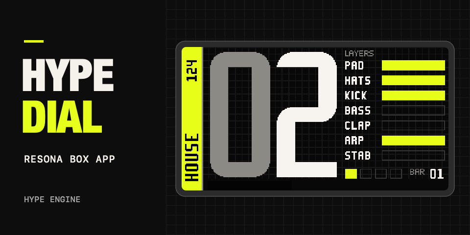

# Hype Dial

转上方旋钮换曲风，转下方旋钮加减伴奏层。弹到想做过渡的地方，可以用 STUTTER 切碎当前节拍，或用 BUILD 接一个 DROP。

## 这一套包含什么

| 文件 | 版本 | 用途 |
| --- | --- | --- |
| `App.rpk` | Hype Dial 0.4.9 | Resona Box 界面、双编码器和演奏控制 |
| `Audio-Pack.rpk` | Hype Engine 0.3.12 | 生成六种曲风的鼓、低音、和弦和旋律，处理吉他与过渡效果 |

先在 Resona Lab 安装 Hype Engine，再安装 Hype Dial。打开 App 后，它会自动加载配套引擎。

## 两个编码器

| 页面／模式 | 上方旋转 | 上方短按 | 上方长按 | 下方旋转 | 下方短按 | 下方长按／按住 |
| --- | --- | --- | --- | --- | --- | --- |
| Hype Dial | 选 House／Techno／Hip-hop／DnB／Funk／Latin；BUILD 时选滚奏细分 | 切换八个低音／和弦根音；DJ 滤波开着时先清除滤波 | 长按使伴奏磁带停转 | 调 ENERGY 0～10 | 触发 STUTTER；BUILD 中按下则安排下一小节 DROP | 长按启动 BUILD，四小节后自动 DROP |

## 项目详细说明

# Hype Dial

One dial from chill to chaos. Turn the energy up from 0 to 10 and an original synthesized groove builds layer by
layer around your guitar; long-press the big encoder for a build, then click it to drop on the next bar. The sound is the nested `dsp/` pack
(**Hype Engine**); the App builds its own Guitar -> Hype Engine -> Output graph and drives it.

Six genres have distinct grooves and instruments already at the startup ENERGY 2. Each has a different four-bar chord, bass and melody phrase; the phrase changes across the four bars. ENERGY 0 keeps a quiet pad and pulse, ENERGY 1 adds a sparse beat, and ENERGY 2 brings in the style's melody. The synthesized drums now layer a low body, harmonic attack and longer filtered tails: House has a warm pad, four-on-the-floor kick and offbeat hats;
Techno has a harder kick, steady 16ths and low bass pulse; Hip-hop has syncopated kick and sub bass, backbeat snare and sparse hats;
DnB has a broken fast kick, rolling hats and bright notes; Funk has syncopated kick and round bass, claps and ghost snare;
Latin has a 3-2 clave, conga-like taps, shaker and tumbao-style bass.
Their guitar paths also differ: House is relatively clean, Techno harder and darker, Hip-hop warmer, DnB tighter and chopped, Funk brighter and snappier, Latin rhythmically warm.
Each genre also has its own synthesized drum voices: House uses a round kick and airy hats; Techno a clipped machine kick, metallic snare and hats;
Hip-hop a deep sine kick and dark snare; DnB a short punchy kick with bright noise snare and hats; Funk a woody kick, tonal rim-like snare and shaker-like hats;
Latin a hand-drum thump, tonal conga, clave tick and shaker.

The pack must be installed in the Box's library first. Until it is, the App shows **INSTALL HYPE ENGINE IN LAB**
and retries once a second.

## Controls

SELECTOR is the top knob, CUSTOMIZE the big one.

| Control | Turn | Click | Long press / hold |
|---|---|---|---|
| SELECTOR (top) | genre: House 124, Techno 130, Hip-hop 90, DnB 172, Funk 110, Latin 108 BPM (commits on the next bar) | next bass/chord root (eight); clears the DJ filter first if it is on | tape stop of the track |
| CUSTOMIZE (big) | ENERGY 0 to 10 | STUTTER; during BUILD, schedule DROP on the next bar | long press: start BUILD; it auto-drops after four bars |

Two-hand moves (require firmware that delivers raw encoder press/release events; firmware 1.04 on the current Box did not deliver them):

| Gesture | Does |
|---|---|
| Top double-click | FILL: one bar of falling toms and a snare crescendo on the next bar |
| Hold top + turn big | DJ filter on the whole mix (left low-pass, right high-pass); stays until the top knob is clicked |
| Hold top + click big | KICK KILL on/off |
| Press big + turn big | SCRATCH the last beat; let go and the track is back on the beat |
| While building, turn top | ROLL 1/4, 1/8, 1/16, 1/32 until the drop |
| Press both together | stop / start of the track |
| Hold both 3 s | reset |
| A hard pick at energy 8+ | chord stab on the next 16th |

The guitar keeps playing through a tape stop or stop; turn either knob or click to restart. After 40 s with no
knobs and no guitar the App shows its attract prompt. Playing guitar dismisses it without changing the selected genre
or ENERGY. LEVEL and BACKING are saved; other controls start fresh after power-up.

If the OS bypasses the engine for its CPU budget, the App shows **CPU LIMIT** and retries after 2 s, then 10 s,
then 30 s while trips keep coming.

## The screen

Brutalist kinetic type on an 8 px grid: a genre accent column (acid yellow house, safety orange techno, signal red
hip-hop, electric cyan drum and bass, green Funk, violet Latin) with the genre and BPM, a giant block numeral for the energy, the LAYERS
roster flashing on its hits, energy ticks, beat squares, the bar count and a line naming what the guitar is doing
(CLEAN, DRIVE, CHOP 1/8, CHOP 1/16).

- **Build**: a countdown of the steps left, speed lines, shake and a progress bar; the release slams DROP full-screen.
- **Genre**: flips through a sliding departure board until the engine commits it.
- **Holding a knob** shows what the other does now (BIG TURN = FILTER, BIG CLICK = KILL; LET GO = ON BEAT while
  scratching).
- Every kick jolts the numerals and flashes the lamp. The beat clock runs on the engine's own step lengths.

The App also writes a boot splash (`src/splash_data.h`) when it differs: the genre accents flash past, HYPE and
DIAL slam in, then the cut to the attract screen. It plays from the next power-up.

## Controller

Play Hype Dial from the Web or Mobile controller (`controller/`) or any MIDI controller: one CC per control on
channel 1; CC 119 asks the App for every value (the channel-16 bench CCs below are separate). LEVEL and BACKING
are saved settings. ROLL applies only during a build.

| CC | Control | Values |
|---|---|---|
| 20 | Energy | 0..127 = 0..10 |
| 21 | Genre | 0 house, 1 techno, 2 hip-hop, 3 DnB, 4 Funk, 5 Latin (commits on the next bar) |
| 22 | Tune | 0..7 |
| 23 | Kick kill | 0 off, 1 on |
| 24 | Filter | 0 full low-pass … 64 clean … 127 full high-pass |
| 25 | Roll | 0 off, 1..4 = 1/4, 1/8, 1/16, 1/32 |
| 26 | Level | 0..127 = 0..100 % |
| 28 | Backing | 0..127 = 0..150 %; adjusts accompaniment without changing guitar level |
| 27 | Now (App -> controller) | 0 playing, 1 build, 2 drop, 3 stop |
| 30 | BUILD (hold) | 127 builds, 0 drops on the next bar |
| 31 | STUTTER | 127 fires a stutter |
| 32 | FILL | 127 plays a fill on the next bar |
| 33 | STOP (hold) | 127 tape stop, 0 restarts |

### Bench control (bench builds only)

Only in a build with `-DRESONA_DEMO_BENCH` (also the bench stats SysEx and frame capture); a normal build ignores
these. USB MIDI **channel 16** CCs call the same handlers as the knobs:

| CC | Action |
|---|---|
| 20 / 21 | Top / big turn; value = 64 + signed detents |
| 22 / 23 | Top / big raw key; 127 down, 0 up |
| 24 / 25 | Top / big click (nonzero) |
| 26 / 27 | Top / big long press (nonzero) |
| 28 / 29 | Top / big double-click (nonzero) |

## DSP: Hype Engine

    pad, hats, kick, bass, clap/snare, arpeggio, chord stab (added with ENERGY)
    guitar -> soft drive -> tone low-pass -> tempo gate / chop
          -> mono sum -> DJ filter -> stutter / scratch / roll (16-bit history) -> soft saturation -> LEVEL

Everything is summed to one mono output. The sequencer runs on the DSP clock, independent of the screen.

| Parameter | Range | Set by the App |
|---|---|---|
| ENERGY | 0 to 10 | big turn (2 at start) |
| GENRE | 0 House, 1 Techno, 2 Hip-hop, 3 DnB, 4 Funk, 5 Latin | top turn |
| BUILD | 0 to 1 | big long press starts it; next click or automatic timeout drops on the next bar |
| STUTTER | 0 to 127 token | big click: any change fires a repeat |
| STOP | 0 to 1 | top long press, both knobs: brakes and silences the track, not the guitar |
| TUNE | 0 to 7 | top click |
| LEVEL | 0 to 100 % | 65, or the controller (saved) |
| FILTER | -100 (low-pass) to 0 (clean) to +100 (high-pass) | hold top + turn big |
| SCRATCH | 0 off, 1 to 33 (the record at -16 to +16 detents) | press big + turn big |
| ROLL | 0 the build's own roll, 1 to 4 = 1/4 to 1/32 | top turn while building |
| KILL | 0 to 1 | hold top + click big |
| FILL | 0 to 127 token | top double-click: any change plays a fill on the next bar |
| BACKING | 0 to 150 % | Web/Mobile/MIDI backing level; default 100 %, saved |

## Build

    resona-lab check dsp
    resona-lab pack build dsp
    resona-lab presets store --request '{"path":"dsp/build/org-resona-demo-hype-engine.rpk"}'
    resona-lab app build .
    resona-lab app install .
    python3 tools/make_splash.py                # regenerate src/splash_data.h (host clang++, numpy)

The glyphs (`src/type.h`) are generated by the App at start; a normal build needs no Python or font files.

MIT, see LICENSE.

## 0.4.9

配套 Hype Engine 0.3.12，调整底鼓起音和响度，减少节拍重复与搓碟刚启动时的断音。
