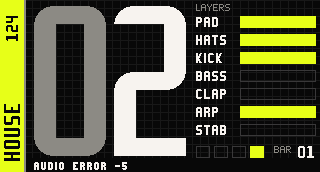

# Hype Dial 0.4.9

用双编码器控制电子节奏层、曲风、Build、Drop 和 Stutter。

先安装下表的配套算法包，再安装 App。

| 文件 | 版本 |
| --- | --- |
| [App.rpk](App.rpk) | Hype Dial 0.4.9 |
| [Audio-Pack.rpk](Audio-Pack.rpk) | Hype Engine 0.3.12 |

[套件说明](套件说明.md) · [App 源码](source/) · [配套算法源码](source/dsp/) · [版本和校验值](manifest.json) · [社区发布文案](社区发布文案.md)
